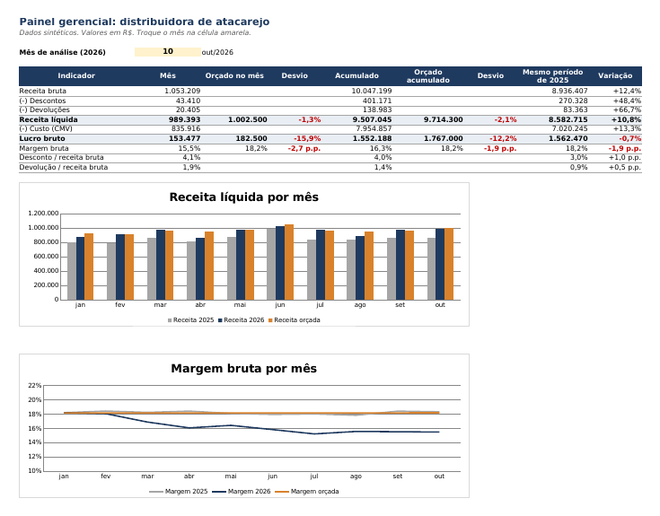

# BI comercial para distribuidora de atacarejo

> A receita cresce, mas o lucro não acompanha. Onde está a margem, e o ano vai fechar dentro do orçamento?

Projeto de portfólio de análise de dados. Parte de extrações simuladas de um ERP e do
orçamento do financeiro e chega a uma planilha gerencial com os números reconciliados.
**Os dados são 100% sintéticos e não representam nenhuma empresa real.**

[**Baixar a planilha gerencial**](entregas/painel_gerencial.xlsx) (não precisa instalar nada além do Excel ou similar)

## Principais achados

**De janeiro a outubro de 2026 a empresa vendeu 10,8% a mais que em 2025, mas lucrou 0,7% a menos.**
O lucro bruto ficou R$ 214,8 mil abaixo do orçamento. Se o ritmo continuar, o ano fecha cerca de
R$ 264 mil abaixo da meta.

| Janeiro a outubro | 2026 | Orçamento | 2025 |
|---|---:|---:|---:|
| Receita líquida | R$ 9,51 milhões | R$ 9,71 milhões | R$ 8,58 milhões |
| Lucro bruto | R$ 1,55 milhão | R$ 1,77 milhão | R$ 1,56 milhão |
| Margem bruta | 16,3% | 18,2% | 18,2% |

### 1. Bebidas vende mais e lucra menos: R$ 91 mil abaixo do orçamento

- **O que aconteceu:** a receita subiu 12,5% sobre 2025 e o lucro caiu 23,2%.
- **Por quê:** de março para abril o custo subiu cerca de 10% e o preço, menos de 2%. A margem foi de 17,1% para 10,0% e não se recuperou.
- **A confirmar com Compras:** o motivo do aumento de custo.

### 2. Dois vendedores triplicaram o desconto: R$ 98 mil de custo

- **O que aconteceu:** desde março os Vendedores 04 e 09 dão cerca de 10% de desconto. Antes davam 3%, como os outros dez.
- **Trouxe venda?** Não há evidência. De março a outubro as vendas brutas dos dois cresceram 11,4% sobre 2025, e as dos outros dez, 12,6%.
- **A confirmar com a Gerência Comercial:** se houve autorização, pressão de clientes ou incentivo na regra de comissão.

### 3. Frios e laticínios voltam vencidos em duas cidades: R$ 24 mil de perda

- **O que aconteceu:** Arapiraca e Palmeira dos Índios somaram R$ 24,1 mil em devoluções por validade, contra R$ 55 no mesmo período de 2025.
- **Desde quando:** começou em junho e passou de R$ 5 mil por mês a partir de julho.
- **A confirmar com a Logística:** se a causa é giro de estoque, rota, refrigeração ou prazo de validade na entrega.

Descontando os R$ 16 mil de desconto que já estão na conta de Bebidas, os três achados somam
**cerca de R$ 197 mil**, na ordem de 90% do desvio de lucro. É uma aproximação: Bebidas é medida
contra o orçamento, e os outros dois contra o padrão de 2025.

### O que eu recomendaria

| Ação | Responsável | Prazo | Como medir |
|---|---|---|---|
| Renegociar custo e revisar preço de Bebidas | Compras e Comercial | 30 dias | Margem mensal de 10% de volta a 18% |
| Exigir aprovação para desconto acima do padrão | Gerência Comercial | 7 dias | Desconto dos dois vendedores de volta a 3% |
| Auditar estoque e entrega de frios nas duas cidades | Logística | 15 dias | Devolução por validade abaixo de R$ 500 por mês |



## O que a planilha responde

| Aba | Pergunta |
|---|---|
| Painel | Como estamos no mês e no ano, contra o orçamento e contra 2025? |
| Orçamento | Cada categoria vai bater a meta? |
| Margem | Onde a margem mudou, por categoria, canal e cidade? |
| Comercial | Algum vendedor usa desconto fora do padrão? |
| Produtos | Quais produtos concentram a receita e quanto volta em devolução? |
| Qualidade | O número é confiável? O que foi excluído e por quê? |
| Premissas | Como cada indicador é calculado? |

O mês é escolhido no Painel e as abas de análise se recalculam por fórmula.

## Como funciona

```
ERP (5 CSVs) ───────┐
                    ├─> Bronze ──> Silver ──> Gold ──> Marts ──> Excel
Orçamento (Excel) ──┘   texto      limpeza    estrela   KPIs
                        original   e regras
```

- **Bronze:** cópia das fontes como texto, sem correção.
- **Silver:** tipos e padronização. Cada linha excluída tem um motivo registrado.
- **Gold:** fatos de vendas, devoluções e orçamento, com dimensões de data, produto, cliente e vendedor.
- **Marts:** definição dos indicadores em SQL.
- **Qualidade:** verificações que interrompem o pipeline se falharem.

Tecnologias: SQL (DuckDB), Python, Excel e pytest.

## Como rodar

Requer Python 3.11+. O LibreOffice é opcional: serve para gravar os resultados das fórmulas
no arquivo e para o teste da planilha.

```bash
python -m venv .venv
source .venv/bin/activate
pip install -r requirements.txt

python run.py                                        # atualiza tudo
python run.py --regerar                              # recria também os dados simulados
python -m pytest                                     # testes
python consultar.py consultas/02_curva_abc.sql       # consultas de exemplo
```

## Estrutura

```
gerador/     simulação do ERP e do orçamento
pipeline/    ingestão, orquestração e montagem do Excel
sql/         Silver, Gold, marts e qualidade
consultas/   perguntas de negócio em SQL
tests/       testes, incluindo recálculo independente de receita e lucro
entregas/    planilha gerencial
```

## Decisões

- **Custo do momento da venda**, para uma mudança de custo não reescrever o passado.
- **Devolução no mês em que ocorre.** Avaria e validade não recuperam custo.
- **Vendas e devoluções unidas com `UNION ALL`**, para o join não duplicar receita.
- **Orçamento em fato próprio**, porque o grão é categoria por mês.
- **Item sem custo é excluído e contado**, porque entraria com lucro inflado.
- **Fórmulas no Excel**, para quem recebe poder auditar cada número.

## Limitações

- Os padrões dos dados foram simulados e são mais nítidos do que seriam numa empresa real.
- Lucro bruto não considera impostos, frete, comissão nem despesas fixas.
- A projeção do ano repete o atingimento médio até outubro e não é um modelo de previsão. Como a margem piorou ao longo do ano, tende a ser otimista.
- Correlação entre desconto e margem é pista de investigação, não prova de causa.
